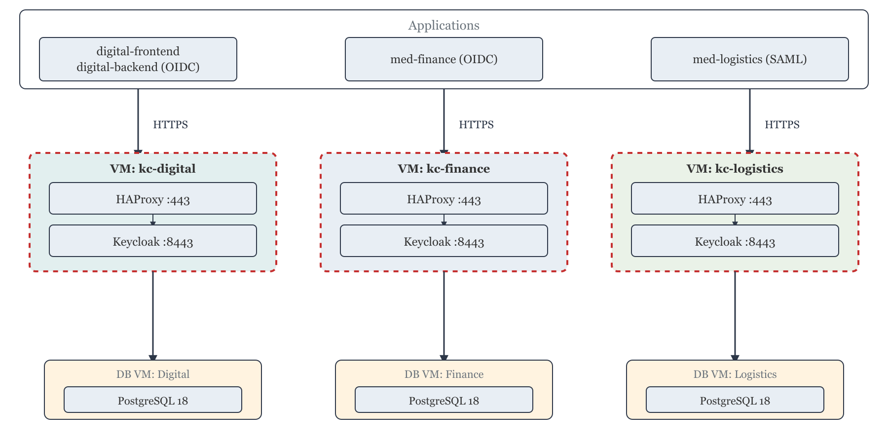
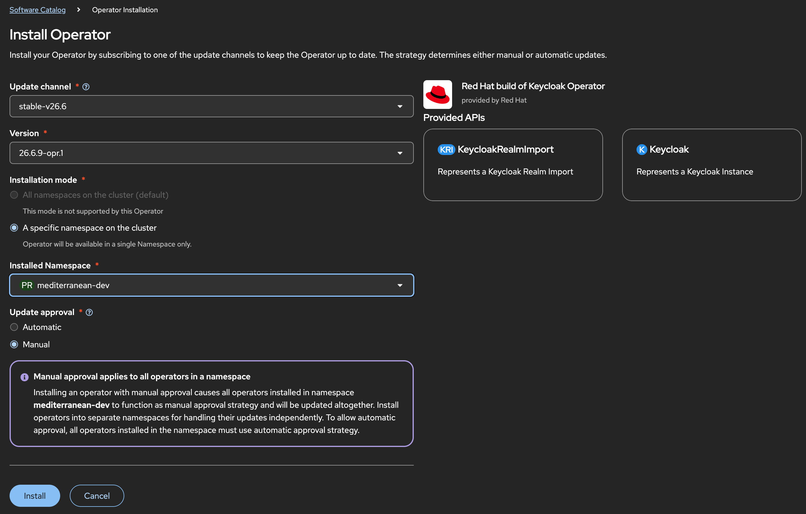
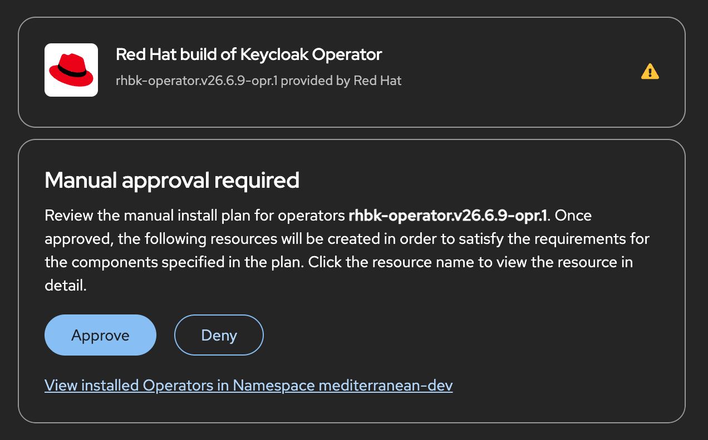
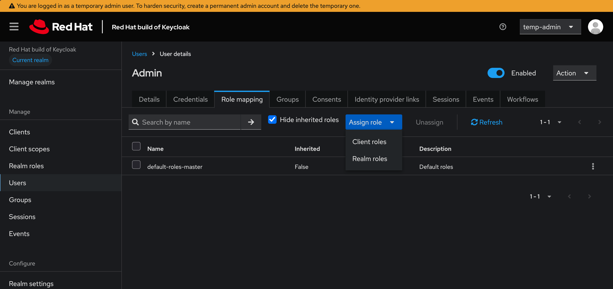
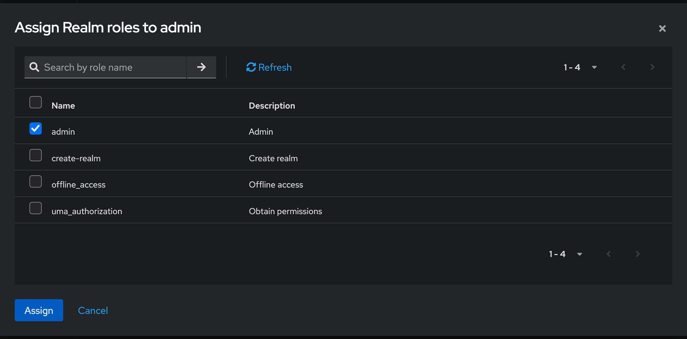
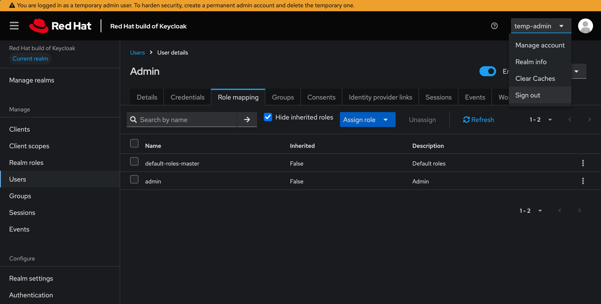
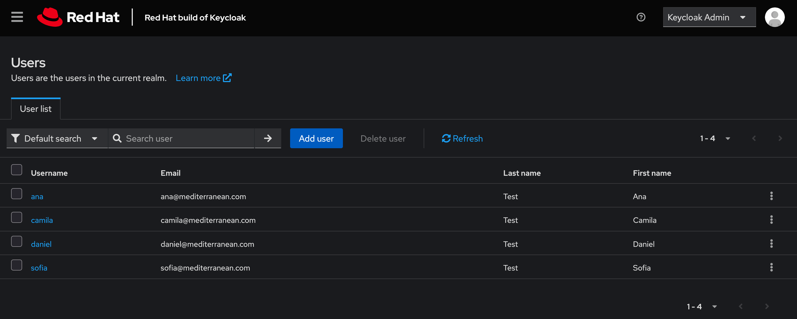
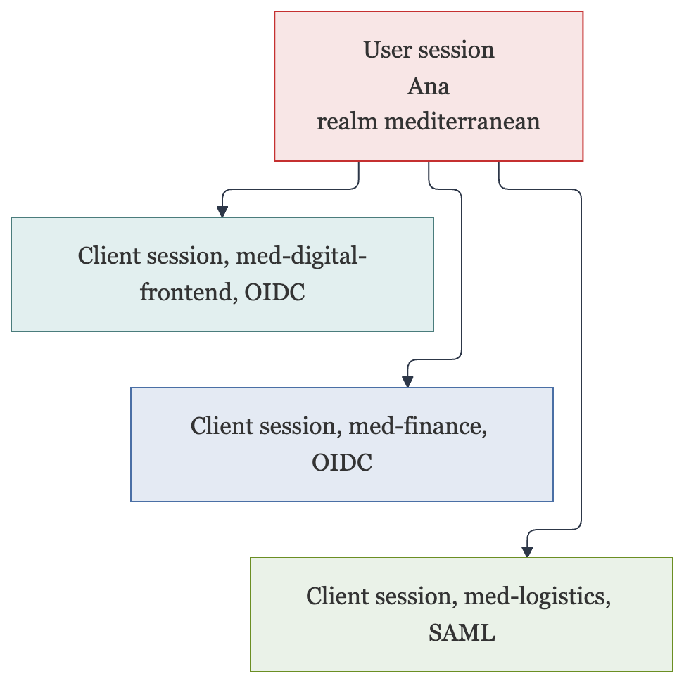
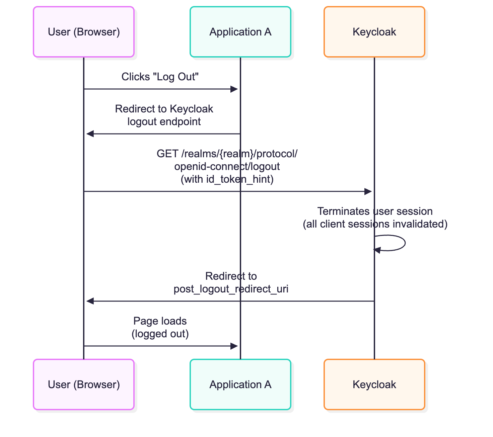
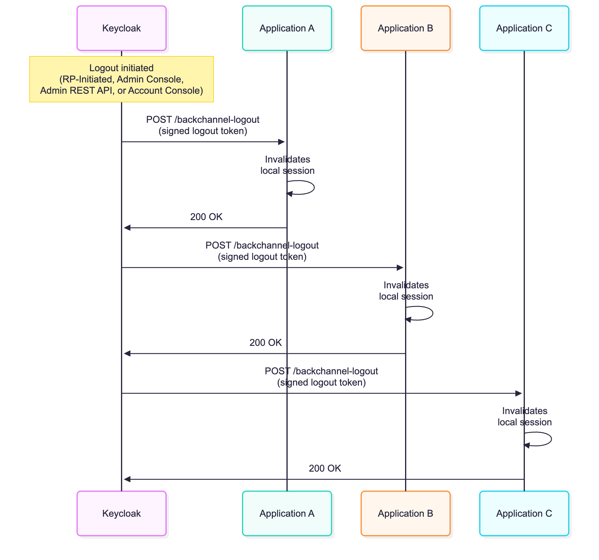

# Capítulo 4 - O Ambiente Compartilhado e a Surpresa do SSO (OpenShift / RHBK)

> **Este guia preserva a versão validada do Capítulo 4 focada em Red Hat Build of Keycloak (RHBK) no OpenShift.** Toda a configuração descrita aqui foi testada e validada em um cluster OpenShift real. O livro principal foi adaptado para Keycloak community + Kubernetes. Este material permanece como referência para quem utiliza OpenShift e RHBK.

---

_De Tres Servidores a Um YAML, e o Login que Ninguem Repetiu_

## Platform Engineering recebe o chamado

Os times de desenvolvimento tinham provado o conceito nas maquinas locais. Cada um rodava seu proprio Keycloak com seu proprio realm, seus proprios usuarios e seus proprios clients. O proximo passo era sair do ambiente local. Cada time enviou um pedido para a equipe de Platform Engineering solicitando um Keycloak acessivel a todos. Tres pedidos separados, todos pedindo a mesma coisa, nenhum mencionando os outros dois.

A equipe de Platform Engineering era um time de nivel holding responsavel pela infraestrutura de todas as subsidiarias. Gerenciavam VMs, redes, certificados e ferramental operacional. Gabriel, engenheiro de sistemas no time, pegou os tres pedidos.

Gabriel nunca tinha ouvido falar de Keycloak antes daqueles tickets. Mas instalar e operar middleware era o trabalho dele, e um servidor de autenticacao nao era conceitualmente diferente dos application servers que ja mantinha. Antes de tocar numa VM, dedicou alguns dias ao estudo. Leu o Server Configuration Guide, o High Availability Guide e a lista de Supported Configurations. Aos poucos, entendeu a separacao entre build e start, os requisitos de banco, TLS e hostname, e os modos de inicializacao. Quando se sentiu seguro, sabia o que precisava para instalar e configurar o Keycloak alem do ambiente de desenvolvimento.

## Do comunitario ao Red Hat Build of Keycloak

A primeira decisao foi a versao. Os times de desenvolvimento tinham usado o Keycloak comunitario 26.6.4 nas maquinas locais, baixado de `https://www.keycloak.org`. Para servidores que ficariam no ar continuamente e seriam acessados por multiplos usuarios, Gabriel precisava de uma versao com suporte. A Red Hat produz uma distribuicao enterprise chamada Red Hat Build of Keycloak (RHBK) a partir do mesmo codigo fonte do projeto comunitario. Os dois compartilham a mesma numeracao de versao principal (26.6), embora os numeros de patch possam diferir entre as releases comunitarias e as do RHBK. O que importa e que sao totalmente compativeis: uma configuracao de client, uma exportacao de realm ou um flow de autenticacao testado no Keycloak comunitario 26.6 funciona da mesma maneira no RHBK 26.6, dada a base de codigo compartilhada. O que o RHBK adiciona sao configuracoes certificadas, manutencao de longo prazo, patches de seguranca com SLAs definidos e o Keycloak Operator para deploy no OpenShift.

> **NOTE:** Na terminologia de projetos open source, o projeto original que produz o codigo fonte e chamado de _upstream_. O produto derivado, que recebe esse codigo e adiciona suporte, certificacoes e ciclo de vida, e chamado de _downstream_. O Keycloak comunitario e o upstream. O Red Hat Build of Keycloak e o downstream. Correcoes e funcionalidades novas nascem no upstream e fluem para o downstream, como um rio que corre de cima para baixo. O caminho inverso tambem acontece: a Red Hat mantem um time de engenharia dedicado ao Keycloak. Correcoes e funcionalidades que esse time desenvolve no downstream sao contribuidas de volta ao projeto comunitario e incorporadas em versoes seguintes do upstream. O codigo produzido com investimento da Red Hat acaba disponivel para toda a comunidade.

O RHBK nao e comercializado como produto independente. O direito de uso esta atrelado a subscricoes Red Hat que o incluem. A Mediterranean Holdings possuia uma subscricao Red Hat Application Foundations (`https://www.redhat.com/en/products/application-foundations`), que cobria o RHBK em VMs, bare metal e OpenShift. Gabriel baixou o ZIP do RHBK 26.6 no Red Hat Customer Portal (`https://access.redhat.com`).

> **NOTE:** A subscricao do Red Hat OpenShift Container Platform (OCP) tambem inclui o RHBK, mas apenas para execucao dentro do proprio cluster OpenShift. Para usar o RHBK em VMs fora do OpenShift, e necessario possuir Red Hat Runtimes ou Red Hat Application Foundations. Os detalhes de entitlement estao no Red Hat Knowledge Base. Consulte a matriz de Supported Configurations do RHBK (`https://access.redhat.com/articles/7033107`) para os links atualizados.

Gabriel olhou para os tres pedidos e viu tres times pedindo a mesma coisa de forma independente. Ninguem tinha combinado. Ele podia ter montado uma instancia compartilhada desde o inicio, mas preferiu dar a cada time o que pediu: uma instancia dedicada numa VM Red Hat Enterprise Linux (RHEL). Procedimento padrao. A consolidacao viria depois, quando ficasse claro que era necessaria.

## A primeira VM ganha vida

Gabriel comecou pela VM da Mediterranean Digital. Tratou esse primeiro setup como uma referencia que poderia replicar para as outras duas, e documentou cada passo.

### O que `start-dev` nao resolve

Gabriel podia ter rodado `start-dev` nas VMs, assim como Daniel tinha feito na maquina local. Mas mesmo para uma POC, ele queria dados persistentes num banco real e TLS na comunicacao. Os times de desenvolvimento apontariam suas aplicacoes para esses servidores por semanas, e ele nao queria que dados de teste desaparecessem toda vez que uma VM reiniciasse.

"O `start-dev` serve para quem esta testando sozinho na maquina dele," Gabriel explicou para Daniel quando recebeu o pedido dele. "Cada VM vai servir um time inteiro, nao um desenvolvedor sozinho. Preciso de banco real, TLS e hostname fixo."

> **NOTE:** O Keycloak distingue entre dois modos de inicializacao. O comando `start-dev` habilita HTTP, usa um banco de desenvolvimento baseado em arquivo (`dev-file`) e pula validacao de hostname. O comando `start` segue um principio de _secure by default_: exige certificados TLS e um hostname configurado. Sem os dois, o servidor recusa iniciar.

### Preparando o sistema operacional

A VM rodava RHEL 10 com uma instalacao limpa. Gabriel criou um usuario de sistema dedicado para o Keycloak para que o processo nunca rodasse como root:

```bash
$ sudo groupadd -r keycloak
$ sudo useradd -r -g keycloak -d /opt/keycloak -s /sbin/nologin keycloak
```

O RHBK 26.6 suporta OpenJDK 17, 21 e 25. Uma instalacao padrao do RHEL 10 inclui o OpenJDK 21. Gabriel verificou:

```bash
$ java -version
openjdk version "21.0.13" 2026-10-20 LTS
```

> **TIP:** Numa instalacao minima do RHEL 10, o OpenJDK pode nao estar presente. Se `java -version` retornar `command not found`, instale com `sudo dnf install -y java-21-openjdk-headless`.

> **NOTE:** Os comandos deste capitulo funcionam em qualquer distribuicao da familia Red Hat: RHEL 10, CentOS Stream 10 e Fedora. O `dnf`, o `systemctl`, o `firewall-cmd` e os demais utilitarios sao os mesmos nas tres distribuicoes. RHEL deriva do Fedora via CentOS Stream, seguindo o pipeline: Fedora (upstream) -> CentOS Stream (midstream) -> RHEL (downstream). O RHBK funciona nessas tres distribuicoes, mas o suporte oficial da Red Hat cobre RHEL (10, 9 e 8) e Windows Server (2022 e 2019). Se a intencao for manter cobertura total de suporte, consulte a matriz de configuracoes suportadas em `https://access.redhat.com/articles/7033107`.

### Instalando o Keycloak

Gabriel criou o diretorio `/opt/keycloak` com permissao de escrita para o usuario `keycloak` e extraiu o conteudo do ZIP:

> **NOTE:** No momento da escrita deste livro, a versao disponivel do RHBK 26.6 era a 26.6.9. Substitua o numero da versao nos comandos se uma versao mais recente estiver disponivel no Customer Portal.

> **TIP:** Numa instalacao minima do RHEL 10, o comando `unzip` pode nao estar disponivel. Se necessario, instale com `sudo dnf install -y unzip`.

```bash
$ sudo mkdir -p /opt/keycloak
$ unzip rhbk-26.6.9.zip
$ sudo cp -a rhbk-26.6.9/. /opt/keycloak/
$ sudo chown -R keycloak:keycloak /opt/keycloak
$ sudo restorecon -R /opt/keycloak
$ rm -rf rhbk-26.6.9
```

> **WARNING:** O comando `restorecon -R /opt/keycloak` restaura o contexto SELinux correto para os arquivos em `/opt`. O `cp -a` preserva os atributos dos arquivos originais, incluindo o contexto SELinux do diretorio onde foram extraidos. O `restorecon` garante que todos os arquivos recebam o contexto padrao esperado para `/opt` (`usr_t`).

### Banco de dados

A Mediterranean Holdings padronizava PostgreSQL como banco de dados relacional em toda a holding. Por politica de backup e protecao de acesso, bancos de dados ficavam em VMs dedicadas, separadas dos servidores de aplicacao. Gabriel verificou na matriz de configuracoes suportadas que o PostgreSQL 18 era compativel com o Keycloak, a mesma versao que a corporacao operava.

Por padrao, o time de DBAs entregava cada banco em sua propria VM dedicada. Gabriel solicitou uma instancia PostgreSQL 18 para o Keycloak da Digital. O DBA provisionou a VM, instalou o servidor, criou o banco e o usuario:

```bash
$ sudo dnf install -y postgresql18-server
$ sudo postgresql-setup --initdb
$ sudo systemctl enable --now postgresql
$ sudo -u postgres createuser --pwprompt keycloak
Enter password for new role: s3cur3P@ss
Enter it again: s3cur3P@ss
$ sudo -u postgres createdb -O keycloak keycloak
```

O Keycloak conecta ao banco via JDBC sobre TCP com autenticacao por senha. O DBA verificou o metodo de autenticacao configurado no arquivo `/var/lib/pgsql/data/pg_hba.conf` para conexoes TCP:

```bash
$ sudo grep "^host" /var/lib/pgsql/data/pg_hba.conf
host    all             all             127.0.0.1/32            ident
host    all             all             ::1/128                 ident
```

O valor padrao no RHEL 10 era `ident`, que tenta mapear o usuario do sistema operacional em vez de aceitar senha. O Keycloak conecta via JDBC e envia usuario e senha, o que exige um metodo de autenticacao baseado em senha. O DBA substituiu `ident` por `scram-sha-256` e reiniciou o servico:

```bash
$ sudo sed -i 's/^\(host.*\)ident/\1scram-sha-256/' /var/lib/pgsql/data/pg_hba.conf
$ sudo systemctl restart postgresql
```

Verificou a mudanca:

```bash
$ sudo grep "^host" /var/lib/pgsql/data/pg_hba.conf
host    all             all             127.0.0.1/32            scram-sha-256
host    all             all             ::1/128                 scram-sha-256
```

> **NOTE:** O `pg_hba.conf` controla quais metodos de autenticacao o PostgreSQL aceita para cada tipo de conexao. `scram-sha-256` e o metodo recomendado. `md5` tambem funciona, mas e menos seguro e esta deprecado. `peer` so funciona em conexoes via Unix socket e e incompativel com JDBC (que sempre conecta via TCP). `ident` funciona via TCP mas e impraticavel com JDBC: exige um servico identd rodando na maquina do Keycloak e autentica pelo usuario do sistema operacional que roda a JVM, nao pelas credenciais configuradas no Keycloak.

> **NOTE:** A instalacao demonstrada aqui e padrao e nao inclui otimizacoes de producao (tuning de `shared_buffers`, `max_connections`, WAL, etc.). O dimensionamento e a otimizacao do banco dependem da carga esperada e sao responsabilidade do time de DBA.

> **TIP:** Se preferir instalar o PostgreSQL na mesma maquina onde o Keycloak roda, o procedimento e o mesmo. A diferenca e que no `keycloak.conf` o valor de `db-url-host` sera `localhost` em vez do hostname do servidor de banco dedicado.

### TLS

O Keycloak em modo de producao (`kc.sh start`) exige HTTPS. Gabriel precisava de um certificado para o hostname da VM. A CA interna da empresa assinaria, mas Gabriel precisava gerar a chave privada e o Certificate Signing Request (CSR) ele mesmo. Para uma POC, um certificado autoassinado tambem funcionaria, desde que gerado corretamente.

O certificado precisava incluir Subject Alternative Names (SANs) com os nomes e IPs pelos quais os clients acessariam o servidor. Sem SANs, navegadores modernos e clients HTTP rejeitam o certificado mesmo que o Common Name (CN) coincida.

> **TIP:** Numa instalacao minima do RHEL 10, o comando `openssl` pode nao estar disponivel. Se necessario, instale com `sudo dnf install -y openssl`.

Gabriel gerou a chave e o certificado autoassinado num unico comando:

```bash
$ sudo -u keycloak openssl req -x509 -nodes -days 365 \
    -newkey rsa:2048 \
    -keyout /opt/keycloak/conf/tls.key \
    -out /opt/keycloak/conf/tls.crt \
    -subj "/CN=kc-digital.mediterranean.internal/O=Mediterranean Holdings/OU=Platform Engineering" \
    -addext "subjectAltName=DNS:kc-digital.mediterranean.internal,DNS:kc-digital,IP:10.0.1.10"
$ sudo chmod 600 /opt/keycloak/conf/tls.key
```

> **WARNING:** O comando acima usa os valores da Mediterranean Holdings. Ao gerar seu proprio certificado, substitua: o valor de `-subj` pelo hostname e organizacao do seu servidor; os valores de `-addext` pelos nomes DNS e IPs pelos quais os clients acessarao o Keycloak. Os SANs devem coincidir exatamente com os nomes usados nas URLs de acesso. Um certificado sem o SAN correto causara erros de TLS em navegadores, `curl` e na maioria das bibliotecas HTTP.

A flag `-x509` gera um certificado autoassinado diretamente, sem passar por uma CA (Certificate Authority). Num deployment real, Gabriel geraria um CSR (Certificate Signing Request) e enviaria para a CA da empresa assinar. Para a POC, o certificado autoassinado era suficiente. O `chmod 600` na chave privada garante que apenas o usuario `keycloak` possa le-la.

### Hostname e keycloak.conf

Gabriel configurou o banco, os caminhos dos certificados e o hostname num unico `keycloak.conf`. O Keycloak escuta HTTPS na porta 8443 por padrao. Gabriel manteve essa porta e configurou um reverse proxy na frente para expor o servico na porta 443, como descrito mais adiante neste capitulo.

```bash
$ sudo tee /opt/keycloak/conf/keycloak.conf <<'EOF'
db=postgres
db-url-host=db-digital.mediterranean.internal
db-username=keycloak
db-password=s3cur3P@ss

https-certificate-file=/opt/keycloak/conf/tls.crt
https-certificate-key-file=/opt/keycloak/conf/tls.key

hostname=https://kc-digital.mediterranean.internal
EOF
$ sudo chown keycloak:keycloak /opt/keycloak/conf/keycloak.conf
$ sudo chmod 600 /opt/keycloak/conf/keycloak.conf
```

> **NOTE:** O `keycloak.conf` nao inclui a opcao `proxy-headers` porque o HAProxy esta configurado em modo TLS passthrough. Nesse modo, o proxy encaminha a conexao TLS diretamente ao Keycloak sem termina-la, e portanto nao adiciona headers HTTP como `X-Forwarded-For` ou `X-Forwarded-Proto`. A opcao `proxy-headers` so e necessaria quando o proxy termina o TLS (modos edge ou reencrypt) e injeta esses headers antes de encaminhar a requisicao.

Depois fez o build do servidor:

```bash
$ sudo -u keycloak /opt/keycloak/bin/kc.sh build
```

> **NOTE:** Durante o build, o Keycloak exibe uma mensagem informando que opcoes de runtime como `db-username`, `db-password`, `hostname` e caminhos de certificados foram encontradas mas serao ignoradas. Isso e esperado. O build le apenas as opcoes de build (como o vendor de banco) e compila um runtime otimizado. As opcoes de runtime entram em vigor na proxima inicializacao.

Gabriel verificou a configuracao resultante:

```bash
$ sudo -u keycloak /opt/keycloak/bin/kc.sh show-config
```

O comando lista todas as opcoes ativas, suas origens (`keycloak.conf`, `Persisted`, `SysPropConfigSource`) e confirma a versao do RHBK. Gabriel conferiu que o banco apontava para o servidor correto, o hostname correspondia ao certificado e o modo estava marcado como `optimized = true`.

> **NOTE:** O passo de `build` le o vendor de banco do `keycloak.conf`, compila a configuracao num runtime otimizado e inclui apenas o driver JDBC para o engine escolhido. Uma instancia do Keycloak compilada para PostgreSQL nao pode conectar em MariaDB, e vice-versa. O build e um passo unico que so precisa ser executado novamente se uma opcao de build mudar (como o vendor de banco). Opcoes de runtime como hostname, certificados TLS e senhas entram em vigor na proxima inicializacao sem necessidade de rebuild.

### Configuracao da JVM

O Keycloak roda na JVM e sua performance depende de configuracoes de memoria adequadas. Gabriel criou um arquivo de ambiente em `/opt/keycloak/conf/keycloak.env`:

```bash
$ sudo tee /opt/keycloak/conf/keycloak.env <<'EOF'
JAVA_OPTS_KC_HEAP=-Xms512m -Xmx2g
JAVA_OPTS_APPEND=-XX:MetaspaceSize=96m -XX:MaxMetaspaceSize=256m -Djava.net.preferIPv4Stack=true
KC_BOOTSTRAP_ADMIN_USERNAME=admin
KC_BOOTSTRAP_ADMIN_PASSWORD=s3cur3P@ss
EOF
$ sudo chown keycloak:keycloak /opt/keycloak/conf/keycloak.env
$ sudo chmod 600 /opt/keycloak/conf/keycloak.env
```

> **NOTE:** A variavel `JAVA_OPTS_KC_HEAP` controla o dimensionamento do heap. Numa VM, Gabriel definiu valores fixos com `-Xms` (inicial) e `-Xmx` (maximo). O script `kc.sh` usa `JAVA_OPTS_KC_HEAP` apenas quando `JAVA_OPTS` nao esta definida. Em ambientes de container, a receita padrao usa `-XX:InitialRAMPercentage=50 -XX:MaxRAMPercentage=70` para calcular o heap como percentual do limite de memoria do container. Numa VM bare metal, configuracoes baseadas em percentual se aplicam a RAM inteira da maquina, o que raramente e o desejado. A variavel `JAVA_OPTS_APPEND` define os limites de metaspace e forca IPv4 para evitar problemas de resolucao em redes que nao suportam IPv6 completamente.

> **NOTE:** Os valores de metaspace (96 MB inicial, 256 MB maximo) correspondem aos padroes que o `kc.sh` define na variavel `JAVA_OPTS`. Ajuste o `-Xmx` com base no numero esperado de sessoes simultaneas e na RAM disponivel na VM. Para uma POC com carga moderada, 2 GB e um ponto de partida razoavel.

> **NOTE:** As variaveis `KC_BOOTSTRAP_ADMIN_USERNAME` e `KC_BOOTSTRAP_ADMIN_PASSWORD` criam a conta de administrador na primeira inicializacao do Keycloak. Nas inicializacoes seguintes, o servidor registra uma mensagem de erro informando que nao conseguiu criar a conta porque ela ja existe, ignora as variaveis e continua a inicializacao normalmente. Elas podem ser removidas do arquivo apos a primeira inicializacao.

### Executando como servico systemd

Para que o Keycloak iniciasse automaticamente com o sistema operacional e fosse gerenciado como qualquer outro servico do RHEL, Gabriel criou um unit file do systemd:

```bash
$ sudo tee /etc/systemd/system/keycloak.service <<'EOF'
[Unit]
Description=Keycloak Server
After=network.target

[Service]
Type=exec
User=keycloak
Group=keycloak
EnvironmentFile=/opt/keycloak/conf/keycloak.env
ExecStart=/opt/keycloak/bin/kc.sh start --optimized
LimitNOFILE=65536
Restart=on-failure
RestartSec=10

[Install]
WantedBy=multi-user.target
EOF
```

> **NOTE:** `--optimized` pula a fase de build e inicia imediatamente. `EnvironmentFile` carrega as opcoes de JVM e as credenciais de bootstrap definidas no `keycloak.env`. `LimitNOFILE=65536` define o limite de file descriptors no unit file (processos do systemd nao passam por PAM, entao `/etc/security/limits.d/` nao tem efeito).

> **TIP:** Se o PostgreSQL estiver instalado na mesma maquina que o Keycloak, adicione `postgresql.service` na diretiva `After` do unit file para garantir que o banco inicie antes do Keycloak: `After=network.target postgresql.service`.

Gabriel habilitou e iniciou o servico:

```bash
$ sudo systemctl daemon-reload
$ sudo systemctl enable --now keycloak
```

Verificou o status:

```bash
$ sudo systemctl status keycloak
● keycloak.service - Keycloak Server
     Loaded: loaded (/etc/systemd/system/keycloak.service; enabled)
     Active: active (running)
```

O servico estava ativo. Gabriel consultou as ultimas linhas do log para confirmar que o Keycloak tinha inicializado sem erros:

```bash
$ sudo journalctl -u keycloak -n 5 --no-pager
```

```
INFO  [io.quarkus] (main) Keycloak 26.6.9 on JVM (powered by Quarkus)
INFO  [io.quarkus] (main) Profile prod activated.
INFO  [io.quarkus] (main) Installed features: [agroal, cdi, hibernate-orm, jdbc-postgresql, keycloak, narayana-jta, reactive-routes, rest, rest-jackson, smallrye-context-propagation, vertx]
INFO  [io.quarkus] (main) Keycloak started in 4.12s. Listening on: https://0.0.0.0:8443
INFO  [org.keycloak.services] (main) KC-SERVICES0077: Created temporary admin user with username admin
```

A mensagem `Listening on: https://0.0.0.0:8443` confirmava que o servidor estava escutando. A mensagem `Created temporary admin user with username admin` confirmava que a conta de administrador tinha sido criada a partir das variaveis de bootstrap. O profile `prod` estava ativo e o driver JDBC era `jdbc-postgresql`. Gabriel confirmou que o Keycloak respondia localmente:

```bash
$ curl -sk https://localhost:8443/realms/master | head -1
```

A resposta era um JSON que comecava com `{"realm":"master"`, confirmando que o Keycloak estava escutando. O acesso externo via navegador viria atraves do HAProxy na porta 443, configurado na secao seguinte.

> **TIP:** Na primeira inicializacao, o log mostra `Created temporary admin user with username admin`. Nas inicializacoes seguintes, essa mensagem nao aparece. Se a conta admin ja existir e as variaveis de bootstrap ainda estiverem no `keycloak.env`, o Keycloak registra uma mensagem de erro no log informando que a criacao falhou e segue normalmente.

### Reverse proxy com HAProxy

O Keycloak escutava na porta 8443. Para que os times de desenvolvimento acessassem o servico na porta padrao HTTPS (443) sem precisar incluir o numero de porta na URL, Gabriel colocou um HAProxy na mesma VM do Keycloak. Em ambientes baseados em VM, o reverse proxy e a pratica recomendada:

* centraliza o ponto de entrada
* permite balancear carga entre multiplas instancias
* adiciona uma camada de protecao ao Admin Console

> **NOTE:** Em ambientes produtivos com multiplas instancias do Keycloak, o HAProxy costuma ficar em VMs dedicadas, separadas dos backends. Isso permite alta disponibilidade do proprio proxy e balanceamento de carga entre varios servidores Keycloak. Para a configuracao atual com uma unica instancia por VM, o HAProxy na mesma maquina e suficiente.

Gabriel instalou o HAProxy:

```bash
$ sudo dnf install -y haproxy
```

Configurou o HAProxy para receber conexoes TLS na porta 443 e encaminhar para o Keycloak na 8443 em modo TLS passthrough:

```bash
$ sudo tee /etc/haproxy/haproxy.cfg <<'EOF'
global
    log /dev/log local0

defaults
    log     global
    mode    tcp
    option  tcplog
    timeout connect 10s
    timeout client  60s
    timeout server  60s

frontend https_in
    bind *:443
    default_backend keycloak

backend keycloak
    server kc1 127.0.0.1:8443 check
EOF
```

> **NOTE:** O modo `tcp` com TLS passthrough encaminha a conexao criptografada diretamente ao Keycloak sem termina-la no proxy. O Keycloak recebe a conexao TLS original e gerencia o certificado. Essa configuracao e a mais simples e nao exige que o proxy tenha acesso ao certificado. Para cenarios em que o proxy precisa inspecionar ou modificar headers HTTP, use o modo `http` com TLS termination no proxy e reencrypt para o Keycloak.

Gabriel abriu a porta 443 no firewall (a porta 8443 nao precisava ser exposta, pois o trafego chegava apenas via HAProxy no loopback) e habilitou o servico:

```bash
$ sudo firewall-cmd --permanent --add-port=443/tcp
$ sudo firewall-cmd --reload
$ sudo systemctl enable --now haproxy
```

Para verificar que o servidor estava rodando, Gabriel consultou o endpoint do realm master atraves do HAProxy:

```bash
$ curl -sk https://kc-digital.mediterranean.internal/realms/master | head -1
```

A resposta era um JSON que comecava com `{"realm":"master"`, confirmando que o HAProxy encaminhava o trafego e o Keycloak respondia com configuracao valida. A flag `-k` pula a verificacao de certificado porque o certificado era autoassinado. Gabriel acessou o Admin Console remotamente e confirmou que tudo funcionava.

> **NOTE:** O hostname `kc-digital.mediterranean.internal` precisa resolver para o endereco IP da VM. Na Mediterranean Holdings, a equipe de Platform Engineering mantinha os registros DNS da zona interna.

> **TIP:** Em ambientes de teste sem DNS, adicione os hostnames manualmente no arquivo de hosts da maquina que vai acessar o Keycloak. No Linux ou macOS, edite `/etc/hosts` (com `sudo`). No Windows, edite `C:\Windows\System32\drivers\etc\hosts` como administrador. Adicione as linhas:
> ```
> 10.0.1.10  kc-digital.mediterranean.internal
> 10.0.1.20  kc-finance.mediterranean.internal
> 10.0.1.30  kc-logistics.mediterranean.internal
> ```
> Substitua os IPs pelos enderecos reais das suas VMs e os hostnames pelos nomes que voce usou no certificado TLS e no `keycloak.conf`.

## A VM de Finance

Gabriel replicou o mesmo procedimento da VM da Digital para a Mediterranean Finance: preparacao do sistema operacional, instalacao do RHBK, banco de dados em VM dedicada, certificado TLS, `keycloak.conf`, JVM, systemd e HAProxy. Os passos eram os mesmos descritos na secao anterior. As diferencas:

* Hostname: `kc-finance.mediterranean.internal`
* Certificado TLS gerado com CN e SANs para `kc-finance.mediterranean.internal`
* `keycloak.conf` com `hostname=https://kc-finance.mediterranean.internal`
* `db-url-host` apontando para a VM de banco dedicada a Finance

## A VM de Logistics

Gabriel repetiu os mesmos passos para a Mediterranean Logistics:

* Hostname: `kc-logistics.mediterranean.internal`
* Certificado TLS gerado com CN e SANs para `kc-logistics.mediterranean.internal`
* `keycloak.conf` com `hostname=https://kc-logistics.mediterranean.internal`
* `db-url-host` apontando para a VM de banco dedicada a Logistics

Tres VMs, tres hostnames, tres certificados, tres bancos dedicados. Todo o resto padronizado.

## O resultado

Em poucos dias, a equipe de Platform Engineering tinha entregue o que os times de desenvolvimento pediram:

* `kc-digital.mediterranean.internal` para Mediterranean Digital
* `kc-finance.mediterranean.internal` para Mediterranean Finance
* `kc-logistics.mediterranean.internal` para Mediterranean Logistics

Todas rodando PostgreSQL 18 no RHEL 10, com TLS, hostname e HAProxy configurados.

> **NOTE:** O Keycloak e compativel com PostgreSQL, MariaDB, MySQL, Microsoft SQL Server e Oracle. A lista completa de versoes suportadas esta no documento Supported Configurations da Red Hat.



## Consolidando a autenticacao no OpenShift

### O que e o OpenShift

O Red Hat OpenShift Container Platform (`https://www.redhat.com/en/technologies/cloud-computing/openshift`) e uma plataforma completa para executar aplicacoes em clusters de servidores.

O OpenShift e baseado em duas tecnologias: containers e Kubernetes (`https://kubernetes.io/`). Um container e um processo que executa uma aplicacao de forma isolada, empacotada com todas as suas dependencias numa imagem de container.

O Kubernetes orquestra esses containers: distribui workloads entre servidores, monitora e reinicia processos que falham, escala instancias sob demanda e gerencia a rede entre eles. O Kubernetes usa um modelo declarativo: o administrador define os workloads em YAML e o Kubernetes garante que o estado real corresponda a definicao.

O OpenShift constroi sobre o Kubernetes e adiciona funcionalidades corporativas: um console web, gerenciamento de builds e imagens, controle de acesso, monitoramento integrado e um catalogo de Operators para instalar e gerenciar middleware de forma declarativa.

Em vez de administrar cada servidor manualmente, como Gabriel fez com as VMs, a equipe descreve o estado desejado e a plataforma se encarrega de mante-lo.

### A decisao de migrar

A Mediterranean Holdings ja vinha adotando o OpenShift como plataforma padrao para seus workloads. A migracao seguia o caminho natural: primeiro o ambiente de desenvolvimento, depois homologacao (UAT), e por fim producao. Alguns workloads ja estavam em execucao nos clusters de desenvolvimento e homologacao. A equipe de Platform Engineering liderava essa transicao.

Apos a validacao e os testes dos times de desenvolvimento nas VMs, o proximo passo seria disponibilizar o Keycloak no ambiente de desenvolvimento do OpenShift, onde as aplicacoes dos tres times ja rodavam.

Em vez de recriar VMs naquele ambiente, a equipe de Platform Engineering decidiu fazer o deploy do Keycloak diretamente no cluster. Um unico trabalho que ofereceria todas as vantagens de um deploy gerenciado pela plataforma:

* Escalabilidade horizontal: escalar o numero de instancias do Keycloak e questao de alterar um unico campo na configuracao
* Tolerancia a falhas: pods que caem sao reiniciados automaticamente; readiness probes param de rotear trafego para pods com problemas
* Rolling updates: com duas ou mais instancias, o Operator atualiza a configuracao sem indisponibilidade
* Infraestrutura como codigo: o deploy e a configuracao podem ser descritos em YAML, versionaveis e reproduziveis
* Balanceamento de carga automatico: o OpenShift Route distribui trafego entre pods sem necessidade de HAProxy manual
* Gerenciamento automatico de TLS: certificados gerados, armazenados e renovados automaticamente pela plataforma
* Health checks automatizados: liveness e readiness probes configurados automaticamente
* Integracao com monitoramento: com `metrics-enabled` habilitado e o monitoramento de projetos de usuario configurado no cluster, o Operator cria um ServiceMonitor que permite ao Prometheus coletar metricas do Keycloak

### A primeira infraestrutura compartilhada

Este passo marcaria uma mudanca. Seria a primeira vez que os tres times compartilhariam a mesma infraestrutura de autenticacao.

Ate aquele ponto, cada time tinha manuseado seu proprio Keycloak e feito as coisas a sua maneira. Num ambiente compartilhado, todos usariam o mesmo realm.

Gabriel ficou responsavel por coletar e consolidar as configuracoes de cada equipe. Foi um trabalho em conjunto e colaboracao para estabelecer o primeiro ambiente compartilhado.

> **TIP:** Acompanhe Gabriel enquanto ele implanta o Red Hat Build of Keycloak no OpenShift usando o Operator. Aplique o YAML, configure o realm, configure o monitoramento. Tudo o que a narrativa descreve corresponde a um passo que voce pode reproduzir. O codigo completo e funcional esta disponivel no repositorio do livro em https://github.com/marcelodsales/keycloak-journey/tree/main/ch04.

> **NOTE:** Se voce nao tem acesso a um cluster OpenShift, o Red Hat OpenShift Local (`https://developers.redhat.com/products/openshift-local`) oferece um cluster single-node completo e gratuito na sua maquina, com OperatorHub e cluster-admin. Requisitos minimos: 4 CPUs, 10,5 GB de RAM, 35 GB de disco. O Developer Sandbox (`https://developers.redhat.com/developer-sandbox`) nao permite instalar Operators.

> **NOTE:** Se voce utiliza Kubernetes sem OpenShift, o projeto Keycloak oferece um Operator comunitario que pode ser instalado em qualquer cluster Kubernetes. A instalacao mais direta usa `kubectl` com Kustomize:
> ```bash
> $ kubectl apply -k 'github.com/keycloak/keycloak-k8s-resources/kubernetes?ref=26.6.4'
> ```
> Os Custom Resources (`Keycloak`, `KeycloakRealmImport`) sao os mesmos. As diferencas em relacao ao OpenShift sao operacionais: no Kubernetes puro, o Ingress e o gerenciamento de certificados TLS precisam ser configurados separadamente. A documentacao do Operator comunitario esta em `https://www.keycloak.org/operator/installation`.

> **NOTE:** Se voce nao tem OpenShift nem Kubernetes, pode acompanhar a narrativa e aplicar os mesmos conceitos na instancia Keycloak que configurou nas VMs na primeira parte deste capitulo. O realm compartilhado, os clients consolidados, os usuarios e o SSO funcionam da mesma forma independente de onde o Keycloak roda. A diferenca e operacional: o que aqui e um Secret do Kubernetes, na VM e uma entrada no `keycloak.conf`. O que aqui e um certificado emitido pelo cert-manager, na VM e o certificado que voce gerou manualmente. As secoes de realm, clients e SSO a partir daqui se aplicam a qualquer instalacao do Keycloak.

> **TIP:** Se o namespace ainda nao existe no seu cluster, crie-o antes de prosseguir:
> ```yaml
> apiVersion: v1
> kind: Namespace
> metadata:
>   name: mediterranean-dev
> ```
> ```bash
> $ oc apply -f namespace.yaml
> ```
> No OpenShift, um namespace e um Project sao equivalentes. Criar um namespace com `oc apply` tem o mesmo efeito de criar um Project com `oc new-project mediterranean-dev`.

### Do OperatorHub ao primeiro CR

Gabriel abriu o console do OpenShift, navegou ate o OperatorHub (*Home > Operators > OperatorHub*) e buscou por "Keycloak". O resultado mostrou o *Red Hat build of Keycloak Operator*. Selecionou o Operator e definiu a estrategia de aprovacao como Manual.




> **TIP:** Aprovacao manual significa que o Operator nao vai se atualizar automaticamente quando uma nova versao for publicada. Num ambiente de desenvolvimento ou producao, voce quer controlar quando upgrades acontecem. Aprovacao automatica e conveniente para desenvolvimento, mas um upgrade surpresa do Operator no meio de um ciclo de release nao e algo que a equipe de Platform Engineering aprecia.

Ao clicar em *Install*, o OpenShift exibiu a tela de aprovacao manual. Como Gabriel tinha escolhido a estrategia Manual, o Operator nao foi ativado imediatamente. A tela mostrava o plano de instalacao para `rhbk-operator.v26.6.9-opr.1` e aguardava a aprovacao antes de criar os recursos necessarios.



Gabriel clicou em *Approve*. A tela confirmou a instalacao.


> **NOTE:** O Operator registra duas Custom Resource Definitions no cluster: `Keycloak` para o deploy do servidor e `KeycloakRealmImport` para importacao de configuracao de realms via YAML. Em vez de editar `keycloak.conf` numa VM, o administrador descreve o estado desejado em YAML e deixa o Operator reconciliar.

A partir daquele momento, o cluster estava pronto para receber instancias do Keycloak. A instalacao do Operator tinha sido simples, o que diminuiu a incerteza da equipe de Platform Engineering e deu mais confianca para seguir com o deploy.

### Banco de dados no OpenShift

> **NOTE:** O Operator nao gerencia o banco de dados. O banco e responsabilidade da organizacao: provisionamento, backup e recuperacao ficam com o time de DBA. O Keycloak conecta ao banco via JDBC, usando hostname e porta. O banco pode estar em qualquer lugar acessivel pela rede: no mesmo cluster, em outro namespace, em outra VM ou num servico gerenciado. As credenciais de acesso sao informadas ao Operator por meio de um Secret do Kubernetes.

O time de DBAs provisionou uma instancia PostgreSQL no cluster. O deploy seguia o padrao interno: um StatefulSet com volume persistente e um Service headless para acesso via DNS estavel. Os YAMLs que o DBA entregou junto com as credenciais:

```yaml
apiVersion: v1
kind: Secret
metadata:
  name: keycloak-db-secret
  namespace: mediterranean-dev
type: Opaque
stringData:
  username: keycloak
  password: keycloak-db-password
---
apiVersion: v1
kind: PersistentVolumeClaim
metadata:
  name: postgresql-keycloak
  namespace: mediterranean-dev
spec:
  accessModes:
    - ReadWriteOnce
  resources:
    requests:
      storage: 8Gi
---
apiVersion: apps/v1
kind: StatefulSet
metadata:
  name: postgresql-keycloak
  namespace: mediterranean-dev
spec:
  serviceName: postgresql-keycloak
  replicas: 1
  selector:
    matchLabels:
      app: postgresql-keycloak
  template:
    metadata:
      labels:
        app: postgresql-keycloak
    spec:
      containers:
        - name: postgresql
          image: registry.redhat.io/rhel9/postgresql-18:latest
          ports:
            - containerPort: 5432
          env:
            - name: POSTGRESQL_USER
              valueFrom:
                secretKeyRef:
                  name: keycloak-db-secret
                  key: username
            - name: POSTGRESQL_PASSWORD
              valueFrom:
                secretKeyRef:
                  name: keycloak-db-secret
                  key: password
            - name: POSTGRESQL_DATABASE
              value: keycloak
          volumeMounts:
            - name: data
              mountPath: /var/lib/pgsql/data
      volumes:
        - name: data
          persistentVolumeClaim:
            claimName: postgresql-keycloak
---
apiVersion: v1
kind: Service
metadata:
  name: postgresql-keycloak
  namespace: mediterranean-dev
spec:
  clusterIP: None
  selector:
    app: postgresql-keycloak
  ports:
    - port: 5432
      targetPort: 5432
```

```bash
$ oc apply -f postgresql-keycloak.yaml
```

> **NOTE:** O Service cria um registro DNS `postgresql-keycloak.mediterranean-dev.svc.cluster.local` que o Keycloak vai usar para conectar ao banco de dados. A configuracao `clusterIP: None` faz com que o DNS resolva diretamente para o IP do pod, sem intermediario. Se o pod reiniciar com outro IP, o DNS atualiza automaticamente.

O Secret `keycloak-db-secret` com as credenciais do banco faz parte do mesmo arquivo. O StatefulSet referencia esse Secret via `secretKeyRef`, garantindo que a senha nao fique exposta nas variaveis de ambiente do pod.

> **WARNING:** Neste exemplo, a senha do banco aparece em texto plano no YAML do Secret. Isso funciona para um ambiente de desenvolvimento, mas em producao a senha nunca deveria estar visivel em arquivos de configuracao. Duas alternativas para resolver isso no OpenShift:
> * *Sealed Secrets* (`https://github.com/bitnami-labs/sealed-secrets`): funciona de forma autonoma, sem depender de nenhum sistema externo ao cluster. Um controller gera um par de chaves e o CLI `kubeseal` criptografa o Secret com a chave publica, produzindo um `SealedSecret` que pode ser armazenado no Git com seguranca. Apenas o controller no cluster consegue decriptar e gerar o Secret real. Apache 2.0.
> * *External Secrets Operator* (`https://external-secrets.io`): indicado para organizacoes que ja possuem um cofre de segredos (Vault, Azure Key Vault, CyberArk, 1Password, AWS Secrets Manager, entre outros). O operator sincroniza os segredos armazenados no cofre com Secrets do Kubernetes. Um `ExternalSecret` define o que buscar e o operator cria e mantem o Secret atualizado. Linux Foundation.

### TLS sem planilha de renovacao

Nas VMs, os certificados TLS tinham sido gerados manualmente com OpenSSL e colocados no filesystem. Se aquele modelo se mantivesse a longo prazo, cada certificado expiraria em algum momento. Para evitar que o servico parasse de responder via HTTPS sem aviso, alguem teria que acompanhar as datas de expiracao de cada certificado em cada servidor, provavelmente numa planilha, revisada periodicamente. Se a renovacao atrasasse, o servico ficaria inacessivel ate que alguem gerasse um novo certificado, copiasse para o servidor e reiniciasse o Keycloak.

No OpenShift, o processo era diferente. A equipe de Platform Engineering usava o cert-manager (`https://cert-manager.io/`), um add-on para Kubernetes e OpenShift que automatiza o ciclo de vida de certificados TLS: criacao, armazenamento em Secrets e renovacao automatica antes da expiracao. O cert-manager monitora a data de expiracao de cada certificado e renova automaticamente quando falta pouco para expirar. Sem intervencao humana. Sem planilha. Funciona com diversas autoridades certificadoras: Let's Encrypt, CAs internas, entre outras.

> **NOTE:** O cert-manager usa dois tipos de recursos. O `ClusterIssuer` define a autoridade certificadora e como os certificados sao obtidos. O `Certificate` define qual certificado e necessario: hostname, Secret de destino e qual issuer usar.

A equipe de seguranca da Mediterranean Holdings administrava a CA corporativa. A chave privada da CA nunca saia do controle deles. No cluster, eles mantinham o Secret com o par de chaves no namespace `cert-manager` e um ClusterIssuer que qualquer namespace podia referenciar para solicitar certificados. Nenhum outro time tinha acesso direto ao Secret nem precisava saber os detalhes da CA.

Os recursos que a equipe de seguranca criou e mantinha:

```yaml
apiVersion: v1
kind: Secret
metadata:
  name: mediterranean-ca-key-pair
  namespace: cert-manager
type: kubernetes.io/tls
data:
  tls.crt: <BASE64_CA_CERTIFICATE>
  tls.key: <BASE64_CA_PRIVATE_KEY>
```

> **TIP:** Para converter os arquivos PEM em base64:
> Linux: `cat ca.crt | base64 -w0`
> macOS: `cat ca.crt | base64 -b0`

```yaml
apiVersion: cert-manager.io/v1
kind: ClusterIssuer
metadata:
  name: mediterranean-ca-issuer
spec:
  ca:
    secretName: mediterranean-ca-key-pair
```

O ClusterIssuer `mediterranean-ca-issuer` era o ponto de contato entre a equipe de seguranca e os times de desenvolvimento. A equipe de seguranca criava e mantinha o ClusterIssuer. Os times de desenvolvimento referenciavam esse nome nos seus recursos Certificate sem precisar saber onde estava a chave, qual era o algoritmo ou quando a CA expirava.

> **NOTE:** A Mediterranean Holdings usa uma CA interna corporativa, mas este nao e o unico modelo possivel. Organizacoes que nao possuem uma CA propria podem usar o cert-manager com o Let's Encrypt (`https://letsencrypt.org/`), uma autoridade certificadora publica e gratuita. Nesse modelo, nao existe Secret com chave privada de CA. O ClusterIssuer se comunica diretamente com a API do Let's Encrypt via protocolo ACME, e a validacao de dominio acontece por DNS challenge (criacao automatica de um registro TXT no provedor DNS) ou HTTP challenge. Os certificados emitidos sao publicamente validos, aceitos por todos os browsers sem configuracao adicional. A unica diferenca para o time de desenvolvimento e o nome do ClusterIssuer no campo `issuerRef` do Certificate.

Gabriel precisava apenas de uma informacao: o nome do ClusterIssuer. Com isso, criou o arquivo `keycloak-tls.yaml`:

```yaml
apiVersion: cert-manager.io/v1
kind: Certificate
metadata:
  name: keycloak-tls
  namespace: mediterranean-dev
spec:
  secretName: keycloak-tls-secret
  issuerRef:
    name: mediterranean-ca-issuer
    kind: ClusterIssuer
  dnsNames:
    - keycloak.apps.mediterranean.internal
```

* `secretName`: o nome do Secret que o cert-manager vai criar com o certificado e a chave privada gerados. Este e o Secret que o Keycloak CR vai referenciar em `http.tlsSecret`.
* `issuerRef`: aponta para o ClusterIssuer que vai emitir o certificado. O `kind: ClusterIssuer` indica que e um recurso de escopo do cluster, nao restrito a um namespace.
* `dnsNames`: a lista de hostnames que o certificado vai cobrir. O certificado so e valido para os dominios listados aqui. Se o Keycloak for acessado por um hostname diferente, o browser vai rejeitar o certificado.

```bash
$ oc apply -f keycloak-tls.yaml
```

O cert-manager leu o Certificate, solicitou a emissao ao ClusterIssuer e armazenou o resultado num Secret chamado `keycloak-tls-secret`. A renovacao aconteceria automaticamente antes da expiracao. Nada de planilhas de controle de certificados.

### Tudo num unico YAML

Com o banco de dados e o certificado TLS no lugar, Gabriel escreveu o arquivo `keycloak.yaml` com o CR do Keycloak:

```yaml
apiVersion: k8s.keycloak.org/v2beta1
kind: Keycloak
metadata:
  name: mediterranean-kc
  namespace: mediterranean-dev
spec:
  instances: 1
  db:
    vendor: postgres
    host: postgresql-keycloak.mediterranean-dev.svc.cluster.local
    usernameSecret:
      name: keycloak-db-secret
      key: username
    passwordSecret:
      name: keycloak-db-secret
      key: password
  http:
    tlsSecret: keycloak-tls-secret
  ingress:
    className: openshift-default
  hostname:
    hostname: https://keycloak.apps.mediterranean.internal
  additionalOptions:
    - name: metrics-enabled
      value: "true"
    - name: health-enabled
      value: "true"
```

> **NOTE:** O CR referencia tres recursos que devem existir antes do `oc apply`: uma instancia PostgreSQL acessivel no namespace (neste caso, em `postgresql-keycloak.mediterranean-dev.svc.cluster.local`), o Secret `keycloak-db-secret` com as credenciais do banco, e o Secret `keycloak-tls-secret` com o certificado TLS (criado pelo cert-manager a partir do recurso Certificate mostrado acima). O Operator Guide lista esses pre-requisitos na secao 2.1.1.

Gabriel aplicou o CR:

```bash
$ oc apply -f keycloak.yaml
```

Menos de um minuto depois, o pod ja estava rodando:

```bash
$ oc get pods -n mediterranean-dev -l app=keycloak
NAME                 READY   STATUS    RESTARTS   AGE
mediterranean-kc-0   1/1     Running   0          45s
```

Gabriel verificou as conditions do CR:

```bash
$ oc get keycloaks/mediterranean-kc -n mediterranean-dev \
    -o go-template='{{range .status.conditions}}CONDITION: {{.type}}{{"\n"}}STATUS: {{.status}}{{"\n"}}MESSAGE: {{.message}}{{"\n"}}{{end}}'
CONDITION: Ready
STATUS: True
MESSAGE:
CONDITION: HasErrors
STATUS: False
MESSAGE:
CONDITION: RollingUpdate
STATUS: False
MESSAGE:
CONDITION: RecreateUpdateUsed
STATUS: Unknown
MESSAGE:
```

Ready True, sem erros, sem rolling update em andamento. O Operator tinha criado um StatefulSet, configurado o container com a conexao ao banco e o certificado TLS, e criado automaticamente uma Route passthrough no OpenShift. O hostname externo ja resolvia para a instancia do Keycloak sem configuracao adicional de Ingress.

Nos capitulos anteriores, cada desenvolvedor tinha criado a conta admin manualmente ao iniciar o Keycloak pela primeira vez. No OpenShift, o Operator cuida disso: ele gera automaticamente um usuario temporario e armazena as credenciais num Secret chamado `<nome-do-cr>-initial-admin`. Gabriel recuperou essas credenciais:

```bash
$ oc get secret mediterranean-kc-initial-admin -n mediterranean-dev \
    -o go-template='username: {{index .data "username" | base64decode}}{{"\n"}}password: {{index .data "password" | base64decode}}{{"\n"}}'
username: temp-admin
password: bf66fd6b25df46caa2632f9eeb070929
```

O usuario `temp-admin` com uma senha gerada automaticamente. Gabriel abriu o navegador em `https://keycloak.apps.mediterranean.internal`, digitou essas credenciais na tela de login do Admin Console e entrou.

O dashboard familiar apareceu na tela. Mandou uma mensagem para Ricardo: "Banco, TLS, hostname, metricas, health checks. Tudo num unico YAML. Tres VMs levaram um dia. Isso levou vinte minutos."

O contraste com o setup nas VMs era evidente. O que tinha levado Gabriel um dia inteiro em tres servidores agora vivia num unico arquivo YAML.

> **NOTE:** Um pod que caisse seria reiniciado automaticamente. Uma mudanca no Secret TLS seria detectada em ate um minuto, disparando um rolling restart. E escalar de uma instancia para duas era questao de mudar `instances: 1` para `instances: 2` no CR.

> **TIP:** Configuracoes comuns como `db`, `hostname` e `http` tem campos dedicados no CR do Keycloak. A secao `additionalOptions` serve para opcoes que nao tem um campo dedicado no CR. Cada entrada mapeia para uma chave do `keycloak.conf` com o mesmo nome. Por exemplo, `log-level` em `additionalOptions` e `log-level` no arquivo de configuracao. O Server Configuration Guide lista todas as opcoes disponiveis.

> **WARNING:** O CR nao inclui uma secao `proxy`. O Operator cria uma Route passthrough por padrao, encaminhando a conexao TLS diretamente ao Keycloak. Pelo mesmo motivo que o HAProxy nas VMs nao exigia `proxy-headers`, a Route passthrough no OpenShift tambem dispensa essa configuracao. No entanto, o Operator Guide (secao 2.1.3.3) adverte que, quando `proxy.headers` nao e especificado, o Operator recorre ao comportamento legado definindo implicitamente `proxy=passthrough`, o que gera warnings de depreciacao no log do servidor. Os valores documentados para `proxy.headers` sao `forwarded` e `xforwarded`, ambos destinados a cenarios onde um reverse proxy intermediario insere headers antes do Keycloak. Para HTTPS passthrough, nenhum dos dois se aplica. Esse fallback sera removido numa versao futura do Operator.

## O realm compartilhado

Antes de configurar qualquer coisa, Gabriel precisava trocar a conta temporaria por um admin permanente. O usuario `temp-admin` gerado pelo Operator era descartavel.

No Admin Console, navegou ate *Users* no realm `master` e clicou em *Add user*.

Preencheu o formulario:

* *Email verified*: *On*
* *Username*: `admin`
* *Email*: `kc-admin@mediterranean.com`
* *First name*: `Keycloak`
* *Last name*: `Admin`


Clicou em *Create*. O console exibiu os dados do usuario criado, com as abas *Details*, *Credentials*, *Role mapping*, *Groups*, *Consents*, *Identity provider links*, *Sessions*, *Events* e *Workflows*.

Na aba *Credentials*, clicou em *Set password*, definiu a senha e desativou o toggle *Temporary*.

Na aba *Role mapping*, a tabela mostrava apenas `default-roles-master` atribuida ao usuario. Gabriel precisava adicionar a role de administrador.

Clicou no dropdown *Assign role*. Duas opcoes apareceram: *Client roles* e *Realm roles*.



> **NOTE:** Uma role no Keycloak e uma permissao nomeada que define o que um usuario pode fazer. Existem dois tipos: realm roles, que sao globais dentro do realm, e client roles, que pertencem a um client especifico. O realm `master` vem com realm roles pre-configuradas para administracao do servidor. A role `admin` concede acesso completo ao Admin Console: criar realms, gerenciar usuarios, configurar clients e alterar qualquer configuracao. Roles serao exploradas em profundidade no Capitulo 5, quando os times precisarem controlar quem pode acessar o que nas aplicacoes.

Gabriel selecionou *Realm roles*. A lista de roles disponiveis apareceu. Marcou a checkbox da role `admin` e clicou em *Assign*.



A tabela de roles agora mostrava duas entradas: `default-roles-master` e `admin`. No topo da pagina, o banner amarelo continuava lembrando: "You are logged in as a temporary admin user. To harden security, create a permanent admin account and delete the temporary one."

Gabriel clicou no nome `temp-admin` no canto superior direito do console e selecionou *Sign out*.



Na tela de login, digitou `admin` e a senha que tinha definido. O dashboard apareceu sem o banner amarelo. A conta permanente estava funcionando.

Gabriel olhou para o console. Era a primeira vez que via o Red Hat Build of Keycloak. O cabecalho mostrava o logo da Red Hat e o texto "Red Hat build of Keycloak" no lugar do logo do Keycloak comunitario. As cores seguiam o esquema visual da Red Hat. Fora isso, era o mesmo console. Os mesmos menus na barra lateral: *Clients*, *Client scopes*, *Realm roles*, *Users*, *Groups*, *Sessions*, *Events*. As mesmas opcoes em *Configure*: *Realm settings*, *Authentication*, *Identity providers*, *User federation*, *Workflows*. Tudo no mesmo lugar, com os mesmos nomes. O RHBK e compilado a partir do mesmo codigo fonte do projeto comunitario. A Red Hat adiciona o esquema visual corporativo, certificacoes e suporte, mas o produto por dentro e o mesmo codigo.

Com o admin permanente no lugar, deletou o Secret que continha as credenciais temporarias:

```bash
$ oc delete secret mediterranean-kc-initial-admin -n mediterranean-dev
```

Apagar o Secret nao remove o usuario `temp-admin` do realm `master`. Alem disso, o Operator pode recriar o Secret no proximo ciclo de reconciliacao. A acao definitiva e excluir o usuario `temp-admin` diretamente no Admin Console. Gabriel ja tinha criado o usuario `admin` permanente e fez exatamente isso.

Credenciais armazenadas em Secrets do Kubernetes sao codificadas em Base64, nao criptografadas. Quanto menos tempo um Secret com senha em texto existir no cluster, melhor.

### O realm mediterranean

Criou o realm `mediterranean`. Nas VMs, cada time tinha criado o mesmo realm na sua propria instancia. No OpenShift, seria um realm unico compartilhado pelos tres times.

### Os clients consolidados

Registrou os clients um a um. Aproveitou a consolidacao para padronizar os nomes: os clients da Digital, que nas VMs se chamavam `digital-frontend` e `digital-backend`, passaram a se chamar `med-digital-frontend` e `med-digital-backend`, seguindo o mesmo padrao de `med-finance` e `med-logistics`.

As configuracoes de cada client seguiam o que os times tinham usado nas VMs. A diferenca principal era o enderecamento: nas VMs, cada time tinha sua propria instancia com hostnames internos dedicados. No OpenShift, as aplicacoes seriam acessiveis por Routes com enderecos HTTPS compartilhados.

Gabriel configurou os *Valid redirect URIs* de cada client com dois enderecos: o primeiro apontando para a Route da aplicacao no OpenShift, o segundo para `localhost`. Como se tratava de um ambiente de desenvolvimento, incluir `localhost` permitia que os desenvolvedores executassem as aplicacoes nas suas maquinas locais e se autenticassem diretamente contra o Keycloak compartilhado no OpenShift. Sem isso, cada desenvolvedor precisaria manter uma instancia local do Keycloak apenas para testar.

#### med-digital-backend

Confidential client, OIDC, com *Client authentication* ligado e todos os flows desmarcados.

Nao recebe redirects. Existe para que o backend valide tokens apresentados por chamadores.

Gabriel registrou o backend primeiro. O frontend precisaria referenciar o backend ao configurar o audience mapper, e essa referencia so funciona se o backend ja existir no realm.

#### med-digital-frontend

Public client, OIDC, com *Require PKCE* ligado.

* *Valid redirect URIs*: `https://digital.apps.mediterranean.internal/*`, `http://localhost:3000/*`
* *Web origins*: `https://digital.apps.mediterranean.internal`, `http://localhost:3000`
* Audience mapper configurado no dedicated scope para incluir `med-digital-backend` no access token. O campo *Included Client Audience* e um combobox que lista os clients existentes no realm. Se o backend nao tiver sido criado antes, ele nao aparece na lista. O Capitulo 3 explica em detalhe como mappers e client scopes funcionam.

#### med-finance

Confidential client, OIDC, com *Client authentication* ligado.

* *Valid redirect URIs*: `https://finance.apps.mediterranean.internal/auth`, `http://localhost:5001/auth`
* *Web origins*: `https://finance.apps.mediterranean.internal`, `http://localhost:5001`
* Client secret gerado na aba *Credentials*.

#### med-logistics

SAML client. Apos salvar o client, Gabriel ajustou duas configuracoes na aba *Settings* que vem desligadas por padrao:

* Na secao *SAML capabilities*, alterou *Name ID format* para `email`.
* Na secao *Signature and Encryption*, ligou *Sign assertions*.
* Na aba *Keys*, desligou *Client signature required*.

Sem *Sign assertions*, o Keycloak envia a assertion SAML sem assinatura. A aplicacao Spring Security SAML2 configurada no Capitulo 3 exige assertions assinadas e rejeita a resposta se a assinatura nao estiver presente.

*Client signature required* vem ligado por padrao em clients SAML. Quando ligado, o Keycloak exige que o AuthnRequest enviado pela aplicacao venha assinado. A aplicacao de Logistics foi configurada no Capitulo 3 com `sign-request: false`. Se o toggle ficar ligado, o Keycloak rejeita o request com "Invalid requester".

Gabriel tambem adicionou o attribute mapper `firstName` para que a assertion SAML incluisse o nome do usuario. No Admin Console, abriu a aba *Client scopes* do client `med-logistics`, clicou no dedicated scope, em *Configure a new mapper*, selecionou *User Property* e preencheu:

* *Name*: `firstName`
* *Property*: `firstName`
* *SAML Attribute Name*: `firstName`
* *SAML Attribute NameFormat*: `Basic`

Redirect URIs e Processing URL:

* *Valid redirect URIs*: `https://logistics.apps.mediterranean.internal/login/saml2/sso/keycloak`, `http://localhost:8082/login/saml2/sso/keycloak`
* *Master SAML Processing URL*: `https://logistics.apps.mediterranean.internal/login/saml2/sso/keycloak`


### Os usuarios de teste

Gabriel tambem criou os usuarios de teste (`daniel`, `camila`, `sofia`, `ana`) com as mesmas credenciais que os times tinham usado na POC e verificou que cada client estava configurado corretamente.



Esses usuarios de teste eram suficientes para validar as configuracoes dos clients e os fluxos de autenticacao. Mas Gabriel sabia que a questao dos usuarios reais era outra conversa. Cada subsidiaria mantinha sua propria base de credenciais: a Digital guardava clientes numa tabela de banco de dados, a Finance mantinha usuarios no banco por tras do servico de autenticacao, e a Logistics armazenava credenciais em arquivos de configuracao. Tres bases, tres formatos, tres historicos diferentes.

Criar quatro usuarios manualmente no console funcionava para os primeiros testes. Para centenas ou milhares de usuarios reais, nao. Importar essas bases para o Keycloak seria necessario ja no ambiente de desenvolvimento, para que os times pudessem validar suas aplicacoes com os mesmos usuarios que existiam nas bases originais. Essa discussao ficou para depois da estabilizacao do ambiente compartilhado.

> **NOTE:** O Operator do RHBK oferece um recurso chamado `KeycloakRealmImport` que permite importar a configuracao de um realm via YAML. Essa funcionalidade e util para automatizar o provisionamento de ambientes e sera explorada no Capitulo 13 quando a Mediterranean Holdings adotar praticas de GitOps. Neste momento, Gabriel configurou o realm manualmente pelo Admin Console.

## Tres times, uma URL

Com o realm configurado e os clients registrados, Gabriel mandou uma mensagem para os tres times de desenvolvimento: o ambiente de desenvolvimento estava pronto. Compartilhou a nova URL do Keycloak e as credenciais da conta de administrador de cada time.

Para os times de desenvolvimento, a migracao foi rapida. O nome do realm era o mesmo e as credenciais dos usuarios eram as mesmas. As diferencas estavam na URL do Keycloak e, no caso da Digital, nos client IDs que Gabriel tinha padronizado durante a consolidacao.

Daniel atualizou dois parametros na configuracao do `keycloak-js`: o `url` para a nova Route do OpenShift e o `clientId` de `digital-frontend` para `med-digital-frontend`. No backend, atualizou o `quarkus.oidc.client-id` e o `quarkus.oidc.token.audience` de `digital-backend` para `med-digital-backend`. Como `med-digital-frontend` e um public client, nao havia client secret para trocar.

Camila precisou de duas mudancas: a issuer URL na configuracao OIDC server-side e o client secret. Gabriel tinha recriado o `med-finance` no OpenShift e o Keycloak gerou um novo secret. Camila copiou o valor da aba *Credentials* e atualizou a configuracao da aplicacao.

Sofia atualizou o SAML entity descriptor com a nova URL de metadata do Keycloak no OpenShift.

Cada time testou sua propria aplicacao e confirmou que o login funcionava. O ambiente estava pronto para uma rodada de testes mais ampla.

## A descoberta do SSO

A primeira pessoa a perceber foi Ana. A mesma Ana que no Capitulo 1 abria uma planilha de senhas toda manha para se autenticar em oito sistemas diferentes. Como testadora do time da Digital, ela tinha contas nas tres aplicacoes porque sua funcao exigia testes entre subsidiarias.

Ana abriu a URL de desenvolvimento da Mediterranean Digital no navegador. A aplicacao a redirecionou para a pagina de login do Keycloak, ela digitou suas credenciais, e a plataforma de e-commerce carregou. Verificou algumas paginas, confirmou os dados que precisava e seguiu em frente.

Abriu uma nova aba e navegou para a URL de desenvolvimento da Mediterranean Finance. O dashboard carregou com o botao *Login*. Ana clicou, esperando ver a tela do Keycloak.

A pagina recarregou instantaneamente. Sem formulario de login. Sem digitar credenciais. O dashboard mostrava seu nome no canto superior, como se ela ja tivesse se autenticado. Mas nao tinha.

Mandou uma mensagem para Camila: "A app de Finance esta com problema? Cliquei em Login e entrei direto, sem digitar nada."

Camila abriu o Admin Console, verificou o client `med-finance` e nao encontrou nada de errado. "Do meu lado esta tudo certo. A aplicacao esta exigindo login normalmente. Tenta Logistics."

Ana abriu a Mediterranean Logistics numa terceira aba. O navegador redirecionou para o Keycloak por um instante e voltou. Sem formulario de login. A pagina de remessas apareceu com seu nome no cabecalho. A aplicacao de Sofia, aquela que falava SAML em vez de OIDC, tambem a reconheceu.

Ana estava autenticada nas tres aplicacoes, em dois protocolos diferentes. Ninguem tinha configurado nada para que isso acontecesse.

Daniel e Camila ja estavam ao lado da Ana. Ricardo apareceu logo depois. O arquiteto lider tinha acompanhado cada passo desde a auditoria de compliance e queria ver com os proprios olhos o que o ambiente compartilhado estava entregando.

Ricardo entendeu primeiro. "Isso e Single Sign-On. Um login, acesso a tudo no mesmo realm."

## Uma sessao, tres aplicacoes

"Mas o que e Single Sign-On?" Ana perguntou. Ela conhecia o problema de ter oito senhas. Nao conhecia o nome da solucao.

Ricardo nao tinha chegado ao Keycloak por acaso. Quando Daniel, Ana e Camila trouxeram o nome depois do meetup, ele tratou de entender do que se tratava. Pesquisou na documentacao oficial, leu um livro sobre o projeto, analisou casos de uso em organizacoes com desafios semelhantes e conversou com arquitetos que ja operavam o Keycloak em producao. Foi essa analise que o convenceu de que a ferramenta resolvia o problema da Mediterranean. Ele sabia o que estava vendo.

"Single Sign-On, ou SSO," Ricardo comecou, "significa que o usuario se autentica uma unica vez e ganha acesso a todas as aplicacoes que compartilham a mesma fronteira de autenticacao. No caso do Keycloak, essa fronteira e o realm. Qualquer client que inicia um fluxo de login no mesmo realm participa do SSO automaticamente. Nao precisa ser configurado, nao precisa ser ativado. E o comportamento padrao. Clients que nao iniciam login, como o `med-digital-backend` que apenas valida tokens, nao recebem redirect de navegador e nao entram nessa sessao."

"Mas como ele sabe que eu ja estou logada?" Ana insistiu, olhando para as tres abas abertas.

Ricardo pediu o navegador da Ana, abriu as ferramentas de desenvolvedor e foi para a aba de cookies. "Olha aqui." Apontou para um cookie chamado `KEYCLOAK_IDENTITY`, associado ao dominio do Keycloak.

Quando Ana logou na Mediterranean Digital, o Keycloak criou duas coisas no servidor: uma *user session* e uma *client session*. A user session pertence ao realm, nao a uma aplicacao especifica. Ela registra que Ana provou sua identidade para o realm `mediterranean`. A client session e filha da user session e rastreia o client especifico que ela acessou, neste caso `med-digital-frontend`.

Nesse mesmo momento, o Keycloak gravou o cookie `KEYCLOAK_IDENTITY` no navegador da Ana. Esse cookie pertence ao dominio do Keycloak, com path no realm (`/realms/mediterranean`), nao ao dominio de nenhuma aplicacao. E ele que conecta o navegador a user session no servidor.

"Entao quando eu cliquei em Login no Finance..." Ana comecou.

"O navegador te redirecionou para o Keycloak," Ricardo completou. "E junto com o redirect, mandou esse cookie. O Keycloak olhou, encontrou sua sessao ativa, e te mandou de volta com os tokens. Sem precisar pedir senha de novo."

Camila entendeu a implicacao. "No Finance tambem? Mesmo sendo um confidential client com server-side flow?"

"O protocolo nao importa," disse Ricardo. "O cookie e entre o navegador e o Keycloak. O Finance fala OIDC, Logistics fala SAML. Os dois passam pelo mesmo Keycloak, o mesmo cookie chega, a mesma sessao e encontrada."

O servidor usou o cookie para localizar a user session ativa de Ana no realm `mediterranean`. Como a sessao existia, criou uma segunda client session sob a mesma user session (para `med-finance`), emitiu os tokens e a mandou de volta. Com Logistics, o mecanismo foi identico: o Keycloak recebeu o cookie, encontrou a sessao, criou uma client session para `med-logistics` e retornou uma SAML assertion assinada. Tudo em milissegundos.



## E o logout?

"E se ela fizer logout de uma app?" Daniel perguntou. "Ela sai de todas?"

"Depende de como a aplicacao implementa o logout," Ricardo respondeu. "O Keycloak suporta dois mecanismos."

O primeiro e o *RP-Initiated Logout*, baseado no navegador. Na terminologia do OpenID Connect, a aplicacao que depende do Keycloak para autenticar seus usuarios e chamada de _Relying Party_, a "parte que confia". RP-Initiated Logout significa que e a propria aplicacao que inicia o processo de logout, redirecionando o navegador para o logout endpoint do Keycloak. O Keycloak encerra a user session, o que invalida todas as client sessions, e redireciona o usuario para uma URL configurada. Funciona quando o usuario clica num botao "Log Out", por exemplo.



O segundo e o *Back-Channel Logout*, servidor para servidor. O nome vem do fato de que a comunicacao acontece por um canal secundario entre os servidores, sem passar pelo navegador do usuario.

Quando um logout e iniciado, seja por RP-Initiated Logout, pelo administrador no Admin Console, pela Admin REST API ou pelo proprio usuario no Account Console, o Keycloak envia um HTTP POST com um logout token assinado para cada client que tem uma back-channel logout URL configurada. E a maneira do Keycloak notificar todas as aplicacoes de que a sessao do usuario foi encerrada. Sessoes que expiram por timeout nao disparam Back-Channel Logout.

Cabe a cada aplicacao tomar as acoes necessarias ao receber essa notificacao, como invalidar sua sessao interna e limpar qualquer estado associado ao usuario. O usuario e deslogado na proxima interacao com aquela aplicacao.



"Qual dos dois a gente usa?" perguntou Camila.

"Back-Channel e o recomendado para aplicacoes server-side como a sua," disse Ricardo. "Nao depende do navegador."

> **TIP:** Para aplicacoes JavaScript usando `keycloak-js`, o adapter detecta mudancas de sessao por meio do mecanismo de Session Management do Keycloak, que consulta o status da sessao via um iframe. Quando a sessao SSO termina, o adapter detecta a mudanca e pode disparar um logout local ou redirect. Isso acontece transparentemente se o adapter for inicializado com `onLoad: "check-sso"` e a opcao `checkLoginIframe`.

"Precisamos configurar isso agora?" perguntou Daniel.

Ricardo avaliou. O ambiente era de desenvolvimento. Os usuarios eram os proprios desenvolvedores. "Nao agora. Quando as aplicacoes se aproximarem de producao, configuramos o Back-Channel Logout em cada client. Por enquanto, se alguem fechar o navegador, o cookie `KEYCLOAK_IDENTITY` e removido automaticamente porque e um cookie de sessao, nao persistente. A sessao no servidor expira sozinha apos um periodo de inatividade."

## Retrospectiva

Este foi um capitulo denso. A equipe de Platform Engineering configurou o Keycloak em VMs com PostgreSQL, certificados TLS, configuracao de JVM, HAProxy como reverse proxy, SELinux e unidades systemd. Depois consolidou tudo numa instancia RHBK no OpenShift usando o Operator, cert-manager para certificados e um banco de dados gerenciado pelo time de DBAs. Gabriel replicou o realm compartilhado, registrou os clients com as configuracoes de redirect para o ambiente OpenShift e localhost, e criou os usuarios de teste.

Os times ajustaram suas aplicacoes para apontar para o novo ambiente. Daniel atualizou a URL, o client ID e a audience. Camila trocou a URL e o client secret. Sofia atualizou a URL de metadata do SAML.

E ganharam algo alem do que tinham planejado. O simples ato de centralizar a autenticacao em um realm, um servidor, deu a eles Single Sign-On entre tres aplicacoes e dois protocolos. Nenhuma configuracao explicita de SSO foi necessaria. Era simplesmente como o Keycloak gerencia sessoes: no nivel do realm, independente do client, independente do protocolo. Pela primeira vez, todos entenderam o que "identidade centralizada" realmente significava na pratica. Nao apenas "um lugar para gerenciar usuarios", mas "uma autenticacao, acesso a tudo."

Ricardo escreveu um resumo para o CTO. Descreveu o ambiente compartilhado, o SSO entre aplicacoes OIDC e SAML, mas foi honesto: autorizacao, controle de quem pode acessar o que, ainda nao existia. A resposta do CTO veio no mesmo dia: "Resultados solidos. O que falta para evoluir isso?" A lista era longa. Controle de acesso, importacao de usuarios reais, branding, monitoramento. Mas pela primeira vez, a Mediterranean tinha uma base sobre a qual construir.

Se voce chegou ate aqui, ja tem uma bagagem solida. Sabe instalar e configurar o Keycloak para ambientes com requisitos de producao, fazer deploy no OpenShift com o Operator, e entende como o SSO funciona por tras dos redirects.

## Para saber mais

Os guias oficiais aprofundam cada um dos temas cobertos neste capitulo.

* *RHBK 26.6 Operator Guide*: https://docs.redhat.com/en/documentation/red_hat_build_of_keycloak/26.6/html/operator_guide/
* *RHBK 26.6 Server Administration Guide (Sessions)*: https://docs.redhat.com/en/documentation/red_hat_build_of_keycloak/26.6/html/server_administration_guide/
* *cert-manager Documentation*: https://cert-manager.io/docs/
* *cert-manager CA Issuer Configuration*: https://cert-manager.io/docs/configuration/ca/
* *cert-manager ACME (Let's Encrypt) Configuration*: https://cert-manager.io/docs/configuration/acme/
* *Let's Encrypt*: https://letsencrypt.org/
* *Sealed Secrets*: https://github.com/bitnami-labs/sealed-secrets
* *External Secrets Operator*: https://external-secrets.io/
* *OpenID Connect Session Management 1.0*: https://openid.net/specs/openid-connect-session-1_0.html
* *OpenID Connect RP-Initiated Logout 1.0*: https://openid.net/specs/openid-connect-rpinitiated-1_0.html
* *OpenID Connect Back-Channel Logout 1.0*: https://openid.net/specs/openid-connect-backchannel-1_0.html
