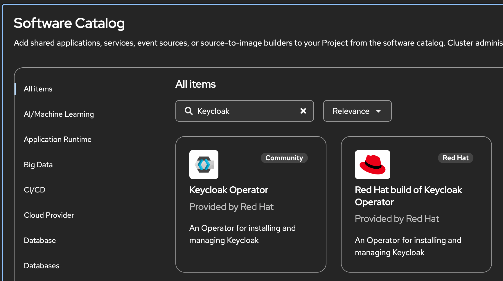
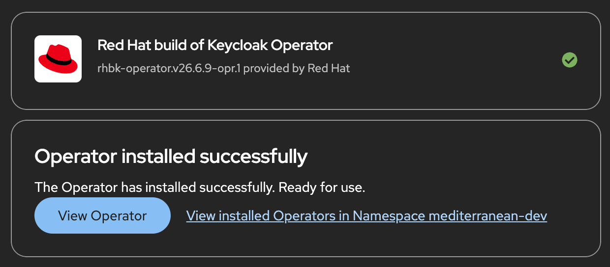
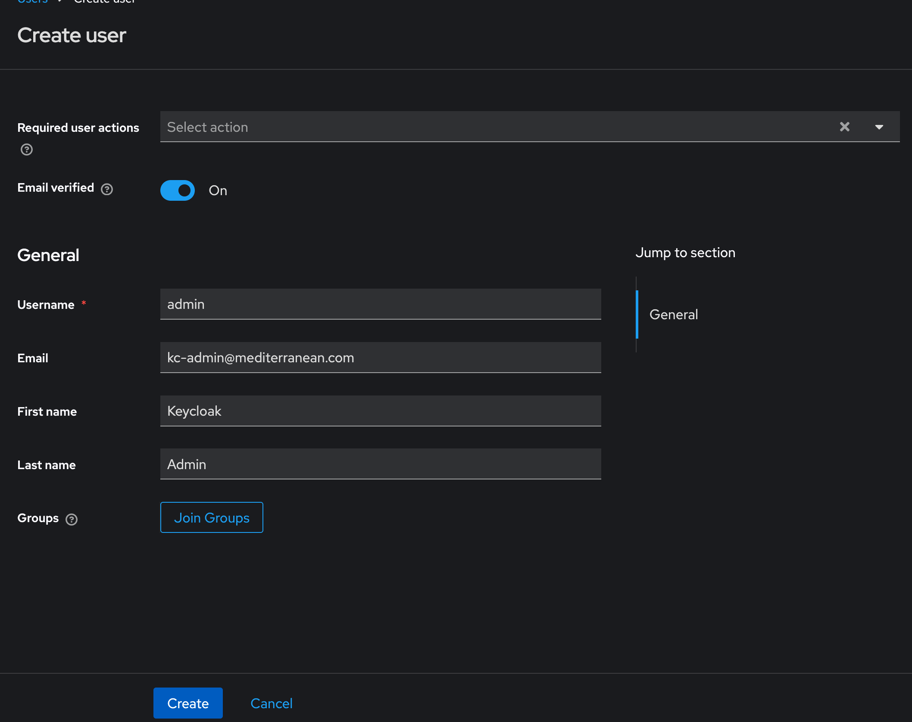
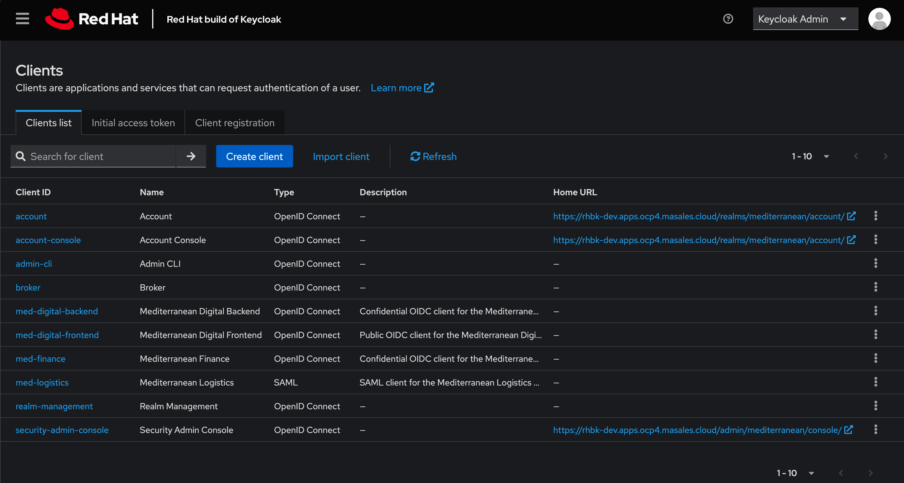

# Chapter 4 - Deploying Red Hat Build of Keycloak on OpenShift

This guide covers deploying Red Hat Build of Keycloak (RHBK) on OpenShift. The book uses Keycloak community on Kubernetes. This material is for organizations that use OpenShift and RHBK.

All configuration was validated on a real OpenShift cluster.

## What differs from Kubernetes

| Aspect | Kubernetes (book) | OpenShift (this guide) |
|--------|-------------------|----------------------|
| Operator install | OLM Subscription from operatorhubio-catalog | OperatorHub UI or CLI from Red Hat catalog |
| Operator image | `quay.io/keycloak/keycloak-operator` | `registry.redhat.io/rhbk/keycloak-rhel9-operator` |
| Keycloak image | `quay.io/keycloak/keycloak:26.8.2` | `registry.redhat.io/rhbk/keycloak-rhel9:26.6` |
| PostgreSQL image | `docker.io/library/postgres:18` | `registry.redhat.io/rhel9/postgresql-18:latest` |
| PostgreSQL env vars | `POSTGRES_USER`, `POSTGRES_PASSWORD`, `POSTGRES_DB` | `POSTGRESQL_USER`, `POSTGRESQL_PASSWORD`, `POSTGRESQL_DATABASE` |
| PostgreSQL data path | `/var/lib/postgresql/data` | `/var/lib/pgsql/data` |
| Ingress | NGINX Ingress with `backend-protocol: HTTPS` annotation | OpenShift Route (created automatically by Operator) |
| TLS | cert-manager Certificate + NGINX Ingress | cert-manager Certificate + Route passthrough |
| Subscription | `source: operatorhubio-catalog`, `sourceNamespace: olm` | `source: redhat-operators`, `sourceNamespace: openshift-marketplace` |

## Installing the RHBK Operator via OperatorHub

Navigate to the OpenShift console: **Operators > OperatorHub**, search for "Keycloak".



Select **Red Hat build of Keycloak** and set approval strategy to **Manual**.


Approve the install plan.


The Operator is installed.



Alternatively, install via CLI:

```yaml
apiVersion: operators.coreos.com/v1alpha1
kind: Subscription
metadata:
  name: rhbk-operator
  namespace: mediterranean-dev
spec:
  channel: stable-v26.6
  name: rhbk-operator
  source: redhat-operators
  sourceNamespace: openshift-marketplace
  installPlanApproval: Manual
```

```bash
oc apply -f rhbk-subscription.yaml
oc get installplan -n mediterranean-dev
oc patch installplan <plan-name> -n mediterranean-dev --type merge -p '{"spec":{"approved":true}}'
```

## PostgreSQL (Red Hat image)

The Red Hat PostgreSQL image uses different env var names and data path.

```yaml
apiVersion: v1
kind: Secret
metadata:
  name: keycloak-db-secret
  namespace: mediterranean-dev
type: Opaque
stringData:
  username: keycloak
  password: keycloak-db-password
---
apiVersion: v1
kind: PersistentVolumeClaim
metadata:
  name: postgresql-keycloak
  namespace: mediterranean-dev
spec:
  accessModes:
    - ReadWriteOnce
  resources:
    requests:
      storage: 8Gi
---
apiVersion: apps/v1
kind: StatefulSet
metadata:
  name: postgresql-keycloak
  namespace: mediterranean-dev
spec:
  serviceName: postgresql-keycloak
  replicas: 1
  selector:
    matchLabels:
      app: postgresql-keycloak
  template:
    metadata:
      labels:
        app: postgresql-keycloak
    spec:
      containers:
        - name: postgresql
          image: registry.redhat.io/rhel9/postgresql-18:latest
          ports:
            - containerPort: 5432
          env:
            - name: POSTGRESQL_USER
              valueFrom:
                secretKeyRef:
                  name: keycloak-db-secret
                  key: username
            - name: POSTGRESQL_PASSWORD
              valueFrom:
                secretKeyRef:
                  name: keycloak-db-secret
                  key: password
            - name: POSTGRESQL_DATABASE
              value: keycloak
          volumeMounts:
            - name: data
              mountPath: /var/lib/pgsql/data
      volumes:
        - name: data
          persistentVolumeClaim:
            claimName: postgresql-keycloak
---
apiVersion: v1
kind: Service
metadata:
  name: postgresql-keycloak
  namespace: mediterranean-dev
spec:
  clusterIP: None
  selector:
    app: postgresql-keycloak
  ports:
    - port: 5432
      targetPort: 5432
```

```bash
oc apply -f postgresql-keycloak.yaml
```

## Keycloak CR

On OpenShift, the RHBK Operator creates a Route automatically. No Ingress annotations needed. The CR does not require `ingress.annotations` because the Route handles TLS passthrough natively.

```yaml
apiVersion: k8s.keycloak.org/v2beta1
kind: Keycloak
metadata:
  name: mediterranean-kc
  namespace: mediterranean-dev
spec:
  instances: 1
  db:
    vendor: postgres
    host: postgresql-keycloak.mediterranean-dev.svc.cluster.local
    usernameSecret:
      name: keycloak-db-secret
      key: username
    passwordSecret:
      name: keycloak-db-secret
      key: password
  http:
    tlsSecret: keycloak-tls-secret
  hostname:
    hostname: https://keycloak.apps.mediterranean.internal
  additionalOptions:
    - name: metrics-enabled
      value: "true"
    - name: health-enabled
      value: "true"
```

```bash
oc apply -f keycloak.yaml
```

Verify:

```bash
oc get pods -n mediterranean-dev -l app=keycloak
oc get keycloaks/mediterranean-kc -n mediterranean-dev \
    -o go-template='{{range .status.conditions}}CONDITION: {{.type}}
STATUS: {{.status}}
MESSAGE: {{.message}}
{{end}}'
```

Retrieve initial admin credentials:

```bash
oc get secret mediterranean-kc-initial-admin -n mediterranean-dev \
    -o go-template='username: {{index .data "username" | base64decode}}
password: {{index .data "password" | base64decode}}
'
```

## Screenshots

The screenshots in this guide were captured on Red Hat Build of Keycloak. The Keycloak community Admin Console is visually identical.

| Screenshot | Description |
|-----------|-------------|
|  | Creating the permanent admin user |
|  | Assign role dropdown |
|  | Selecting the admin realm role |
|  | Signing out of temp-admin |
|  | Clients registered in the mediterranean realm |
|  | Test users created in the mediterranean realm |

## Realm, clients, and users

Realm configuration, client registration, and user creation are identical between RHBK and community Keycloak. Follow the book's Chapter 4 instructions for these steps. The only difference is the hostname used in redirect URIs.
